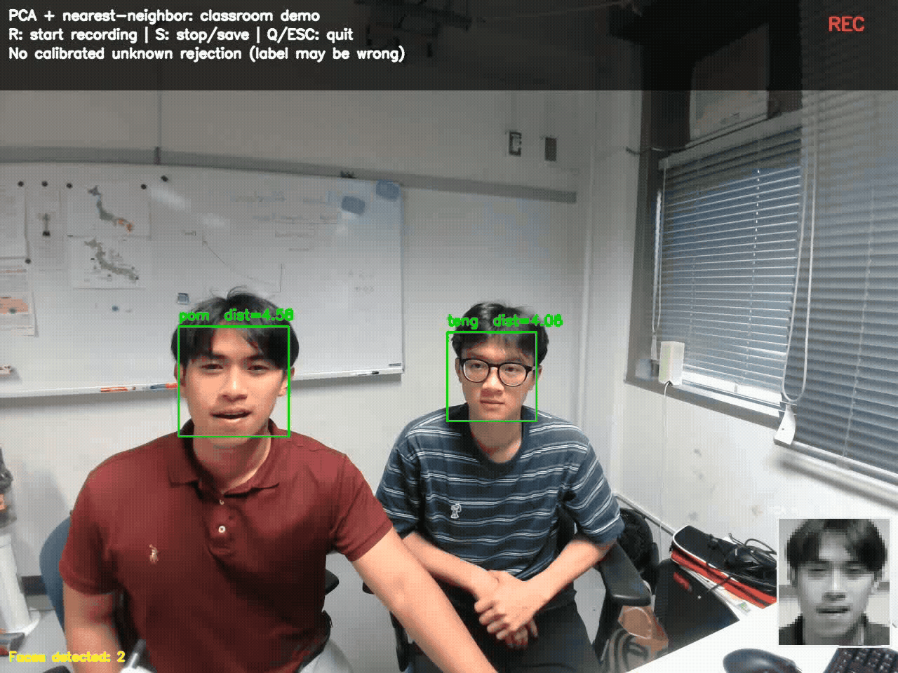

# Week 1 — Introduction to Face Recognition with Eigenfaces (PCA)

**研修１ / Week 1 — 固有顔（Eigenfaces）と主成分分析（PCA）による顔認識入門**

This week introduces the complete *classical* face-recognition workflow: images → face detection → preprocessing → PCA/Eigenfaces → nearest-neighbor matching. Students first study the theory in the Jupyter notebooks, then try a separate real-time webcam application.

この週では、**画像の取得 → 顔検出 → 前処理 → PCA・固有顔 → 最近傍法による人物識別**という流れを学びます。まずJupyter Notebookで原理を学び、その後、独立したWebカメラプログラムで実験します。

> **Educational use only / 教育目的のみ:** This is a classroom demonstration, not a secure identity-verification system. Obtain consent before photographing classmates and do not publish their images or registrations.

## Demo: Real-Time Face Recognition

<p align="center">
  
</p>

---

## 1. Learning objectives / 学習目標

By the end of Week 1, you should be able to:

1. Explain how a grayscale image is represented as a numerical vector. / グレースケール画像を数値ベクトルとして表現できる。
2. Explain the mean face, PCA, SVD, and Eigenfaces. / 平均顔、PCA、SVD、固有顔を説明できる。
3. Distinguish **face detection** from **face recognition** and **tracking**. / 顔検出・顔認識・顔追跡の違いを説明できる。
4. Explain nearest-neighbor recognition in PCA feature space. / PCA特徴空間での最近傍法を理解する。
5. Register and recognize a consenting participant with the webcam demonstration. / 同意を得た人物をWebカメラで登録し、照合する。
6. Recognize limitations caused by lighting, pose, alignment, and unknown identities. / 照明・姿勢・位置合わせ・未登録人物による制約を理解する。

## 2. Required software / 必要なソフトウェア

- **Python 3.11** recommended / 推奨
- **Anaconda or Miniconda** (optional but recommended) / 推奨
- **VS Code** with the Python and Jupyter extensions / Python・Jupyter拡張機能
- A working webcam (for the live exercise) / Webカメラ
- **Git** and a GitHub account (only for version-control exercises) / Git・GitHub

The standalone webcam program uses the following Python packages:

```txt
numpy>=1.24,<3
opencv-python>=4.8
scikit-learn>=1.3
joblib>=1.3
```

The notebooks may additionally need `matplotlib`, `pandas`, `Pillow`, `scipy`, `jupyter`, and `ipykernel`.

## 3. Suggested project structure / フォルダ構成

```text
Week-1/
├── README.md
├── requirements.txt
├── webcam_eigenfaces.py
├── Eigenfaces_PCA_Bilingual_Student.ipynb   # if supplied / 配布された場合
├── Yale_Faces_Images/                       # local dataset / ローカルデータ
│   ├── person_01/
│   │   ├── face_01.png
│   │   └── ...
│   ├── person_02/
│   └── ... person_38/
├── saved_model/                             # generated / 自動生成
│   ├── eigenfaces.joblib
│   └── gallery.npz
├── enrolled_faces/                          # generated; private / 個人情報
│   └── student_01/
│       ├── color_crops/
│       └── grayscale_pca/
└── recordings/                              # generated; private / 録画
    └── recognition_*.mp4
```

Only the relevant supplied files must exist. The `saved_model`, `enrolled_faces`, and `recordings` directories are created or populated by the program. The Yale image folder must be extracted beside `webcam_eigenfaces.py` unless you pass `--data` during training.

配布されたファイルだけを配置してください。学習モデル・登録写真・録画のフォルダは実行時に作成されます。Yale画像フォルダは通常、Pythonファイルと同じ階層に置きます。

## 4. Create an environment / Conda環境の作成

Open **Anaconda Prompt** on Windows 11, or a terminal with Conda enabled on macOS:

```bash
conda create -n eigenfaces python=3.11 -y
conda activate eigenfaces
```

From your `Week-1` folder install dependencies:

```bash
python -m pip install -r requirements.txt
python -m pip install matplotlib pandas pillow scipy jupyter ipykernel
```

Verify the OpenCV face detector:

```bash
python -c "import cv2; print(cv2.__version__); print('Haar Cascade available:', hasattr(cv2, 'CascadeClassifier'))"
```

It should print `Haar Cascade available: True`.

### VS Code / VS Codeで実行

1. Choose **File → Open Folder...** and open `Week-1`.
2. Open the Command Palette (`Ctrl+Shift+P` on Windows, `Cmd+Shift+P` on macOS).
3. Choose **Python: Select Interpreter** and select the `eigenfaces` Conda environment.
4. For `.ipynb` files, also select the matching notebook kernel.
5. Run commands below from **Terminal → New Terminal**.

## 5. Part A — Learn PCA with the notebook / NotebookでPCAを学ぶ

If the bilingual student notebook is included, work through it in order:

1. Inspect grayscale face images and their labels. / 顔画像とラベルを確認する。
2. Compute the mean face and subtract it. / 平均顔を求め、平均を引く。
3. Apply PCA/SVD and visualize Eigenfaces. / PCA・SVDで固有顔を求める。
4. Project and reconstruct test faces. / 射影・再構成を行う。
5. Use nearest-neighbor matching to predict identities. / 最近傍法で人物を予測する。
6. Evaluate errors and discuss unknown-person rejection. / 誤認識と未登録人物の判定を考える。

**Key equations / 重要な数式**

Mean face / 平均顔:

$$\mu = \frac{1}{N}\sum_{i=1}^N x_i$$

PCA projection / 主成分空間への射影:

$$z = U_k^T(x-\mu)$$

Reconstruction / 顔画像の再構成:

$$\hat x = \mu + U_k z$$

Nearest-neighbor identity / 最近傍法による人物識別:

$$i^* = \arg\min_i \left\|z_{\mathrm{test}}-z_i\right\|_2$$

PCA extracts features; nearest-neighbor matching uses those features to predict a registered identity. / PCAは特徴を抽出し、最近傍法がその特徴を使って人物を識別します。

## 6. Part B — Train the standalone webcam program / Webカメラプログラムの学習

The webcam application is **separate from the notebook** and reads PNGs in `Yale_Faces_Images/person_XX/`. It does not need the MATLAB `.mat` dataset.

WebカメラプログラムはNotebookとは独立して動作し、YaleのPNG画像を読み込みます。MATLABファイルは不要です。

Train PCA and create the initial Yale gallery:

```bash
python webcam_eigenfaces.py train
```

If a model already exists, **do not retrain unnecessarily**. To deliberately replace the model and gallery:

```bash
python webcam_eigenfaces.py train --force
```

**Warning / 注意:** `--force` rebuilds the gallery and removes currently enrolled webcam IDs from it. Back up `saved_model/` first. Photos may remain on disk and can be restored afterward.

Check identities:

```bash
python webcam_eigenfaces.py status
```

## 7. Part C — Enroll a new person / 新しい人物の登録

With the participant's permission, run:

```bash
python webcam_eigenfaces.py enroll --id student_01
```

The webcam shows a green face-position guide, prompts, and a collection counter. The program plans **30 photos**: 10 frontal, 5 slight left, 5 slight right, 5 smiling, and 5 looking slightly up.

Webカメラに緑色の顔位置ガイドと指示・撮影枚数が表示されます。正面10枚、左向き5枚、右向き5枚、笑顔5枚、上向き5枚の合計30枚を収集します。

| Key / キー | Enrollment action / 登録時の操作 |
|---|---|
| `Space` or `S` | Capture one photo / 1枚撮影 |
| `Q` or `Esc` | Stop enrollment / 登録を終了 |

An incomplete 30-photo session is **not added to the gallery**. The saved face crops remain in `enrolled_faces/<id>/`. Each enrollment stores a color crop and the corresponding **42 × 48 grayscale PCA image**.

30枚に満たない登録はギャラリーに追加されませんが、撮影済み画像は残ります。

## 8. Part D — Live face recognition / リアルタイム顔認識

```bash
python webcam_eigenfaces.py recognize
```

For another connected webcam, try:

```bash
python webcam_eigenfaces.py recognize --camera 1
```

The program detects faces using **OpenCV Haar Cascade**, transforms each detected face to the Yale-trained PCA space, and selects its closest gallery feature by Euclidean distance. It does **not** perform persistent temporal face tracking.

顔検出にはOpenCVのHaar Cascade、特徴抽出にはPCA、人物照合にはユークリッド距離による最近傍法を使用します。連続フレーム間の顔追跡は実装されていません。

### Recognition and video keys / 認識・録画ショートカット

| Key / キー | Action / 動作 |
|---|---|
| `R` | Start MP4 recording / 録画開始 |
| `S` | Stop **and save** recording; webcam keeps running / 録画停止・保存（カメラは継続） |
| `Q` or `Esc` | Exit webcam; finalize an active recording / カメラ終了 |

Recordings are saved under `recordings/` **without audio**. The writer uses a nominal frame rate, so recorded playback timing may differ from real-world time if recognition is slower than that rate.

録画ファイルは`recordings/`に保存され、音声は含まれません。処理速度によっては再生時間と実時間が一致しない場合があります。

> **Unknown people / 未登録人物:** With no threshold, 1-nearest-neighbor matching always returns a gallery label—even for an unregistered person. The optional `--threshold` setting is experimental and should be calibrated using separate validation identities before interpreting its decisions.

## 9. Part E — Manage identities / 登録IDの管理

List identities / ID一覧:

```bash
python webcam_eigenfaces.py status
```

Remove an identity from the gallery while **keeping its photographs** / 写真を残してIDを削除:

```bash
python webcam_eigenfaces.py delete --id student_01
```

Restore that ID from its previously saved grayscale photos / 既存の画像からIDを復元:

```bash
python webcam_eigenfaces.py restore --id student_01
```

Restoration requires `enrolled_faces/student_01/grayscale_pca/*.png` and uses the currently saved PCA model. It does **not** retrain PCA.

To remove both gallery features and saved enrollment photos / IDと写真を両方削除:

```bash
python webcam_eigenfaces.py delete --id student_01 --delete-photos
```

**Irreversible unless you have backups:** Once photos are deleted, `restore` cannot recover them. Deleting a Yale ID from the gallery does not delete its original dataset images; retraining from Yale will add it back.

## 10. GitHub and data privacy / GitHubとデータ保護

**Commit source code and documentation, not webcam face photos, model galleries, or recordings.** Before running `git add .`, create a `.gitignore` in the Week-1 folder:

```gitignore
# Python and environments
__pycache__/
*.pyc
.venv/
venv/
.env

# Private registrations, face images, generated PCA artifacts
Yale_Faces_Images/
enrolled_faces/
saved_model/
recordings/
*.joblib
*.npz
*.mp4

# Other local data artifacts
.DS_Store
.ipynb_checkpoints/
```

To ignore **every PNG** across the repository, also add `*.png`. If you intend to keep selected non-sensitive PNG diagrams under version control, omit the broad `*.png` pattern and ignore only the dataset and enrolled-photo folders.

If Git already tracks a sensitive file, adding `.gitignore` does not untrack it. For example:

```bash
git rm -r --cached -- enrolled_faces/ saved_model/ recordings/
```

Only run that command for paths that are currently tracked, and check `git status` before committing. Removing files from the current Git index does **not** erase copies in previous commits; avoid uploading private face images in the first place.

### VS Code → GitHub / VS CodeからGitHubへ

1. Open your Week-1 folder in VS Code. / フォルダを開く。
2. Open **Source Control** and initialize a repository if necessary. / Gitリポジトリを初期化する。
3. Review changed files and stage only the intended code, README, and requirements. / 追加するファイルを確認する。
4. Write a commit message and select **Commit**. / コミットする。
5. Sign in to GitHub, then **Publish Branch** or **Push/Sync Changes**, depending on your repository setup. / GitHubへ公開・プッシュする。
6. Open GitHub to confirm the files arrived. / GitHub上で確認する。

**Save ≠ Commit ≠ Push.** / **保存・コミット・プッシュは別の操作です。**

## 11. Troubleshooting / トラブルシューティング

| Symptom / 問題 | Try / 対応 |
|---|---|
| `CascadeClassifier` missing | Verify `cv2.__file__` and `cv2.__version__`; remove conflicting OpenCV packages and install the desktop `opencv-python` package in the active environment. |
| `Yale_Faces_Images` not found | Extract the dataset so `Yale_Faces_Images/person_01/face_01.png` exists beside the script. |
| Camera cannot open | Allow camera access for VS Code/Terminal, close other camera apps, or try `--camera 1`. |
| PCA model version warning | Use a compatible scikit-learn version or deliberately retrain in the current environment after backing up your gallery. |
| Enrollment refuses same ID | Check `status`. If the ID was deleted but photos remain, use `restore --id` instead of enrolling again. |
| Predictions change with lighting or pose | Improve consistent cropping and illumination; this classical method is sensitive to alignment and domain differences. |
| MP4 does not save | Check write permissions, disk space, and OpenCV codec support; stop with `S` or quit normally to finalize. |

## 12. Review questions / 復習問題

1. Why do we convert webcam faces to grayscale before using this Yale-trained PCA model? / なぜWebカメラ画像をグレースケールに変換する必要がありますか。
2. What is the difference between face detection and face recognition? / 顔検出と顔認識の違いは何ですか。
3. Why can an unknown face receive a registered person's label? / 未登録人物に既存のIDが付くのはなぜですか。
4. Does adding a new registered identity require PCA retraining? Why? / 新しい人物の追加にPCAの再学習は必要ですか。
5. Why should students not upload `enrolled_faces/` or `gallery.npz` to GitHub? / 顔画像や特徴データをGitHubにアップロードすべきでない理由は何ですか。

## 13. References / 参考資料

- Brunton, S. L., & Kutz, J. N. *Data-Driven Science and Engineering*, Chapter 1, §§1.5–1.6 (PCA and Eigenfaces).
- Sirovich, L., & Kirby, M. (1987). *Low-dimensional procedure for the characterization of human faces*.
- Turk, M., & Pentland, A. (1991). *Eigenfaces for Recognition*.
- [OpenCV documentation](https://docs.opencv.org/)
- [scikit-learn PCA documentation](https://scikit-learn.org/stable/modules/generated/sklearn.decomposition.PCA.html)
- [VS Code Source Control documentation](https://code.visualstudio.com/docs/sourcecontrol/overview)

---

**Instructor note / 教員向け:** Students should treat the Yale-based webcam recognition accuracy as an experimental outcome—not proof that the system reliably verifies someone's identity. Collect evaluation images separately from enrollment images, and obtain explicit consent for the webcam exercise.
